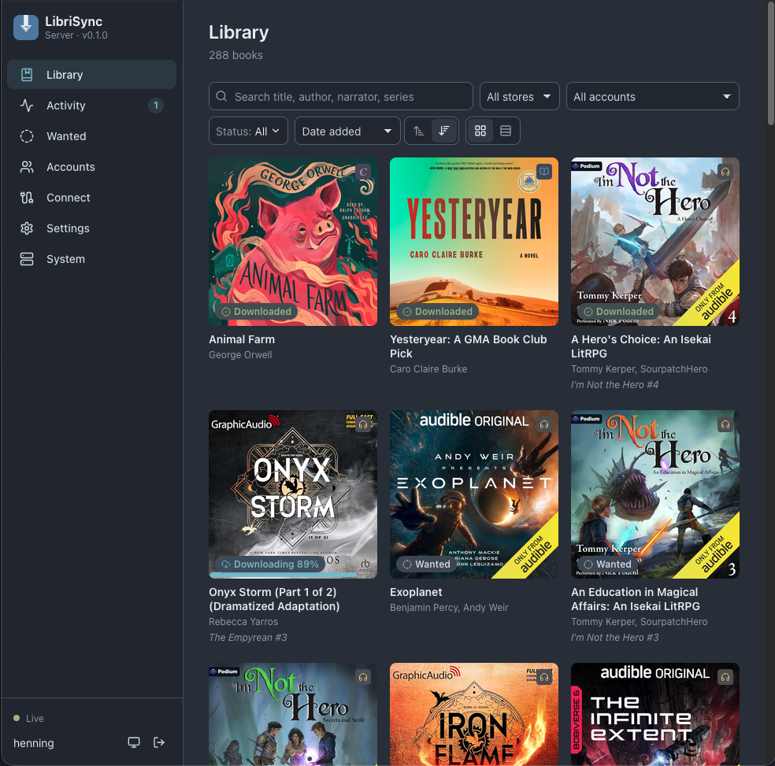

# LibriSync

Libation for Android. Sync, download and keep the audiobooks you've bought on **Audible**,
**Libro.fm** and **Chirp**, and browse thousands of free **LibriVox** books, all in one app.

**[henning.tech/librisync](https://henning.tech/librisync)** · [Google Play](https://play.google.com/store/apps/details?id=tech.henning.librisync) · [GitHub Releases](https://github.com/Promises/LibriSync/releases) · [LibriSync Server](server/)

LibriSync is essentially **[Libation](https://github.com/rmcrackan/Libation)** on your
phone. Its core is a direct port of Libation's C# codebase to Rust, so you get the same
proven library-sync and download engine, native on Android.

> **Want it on a home server instead?** **[LibriSync Server](server/)** runs the same engine
> as a self-hosted Docker service with a web UI, Sonarr/Radarr-style. It syncs every account
> daily, downloads new purchases automatically, and works through your existing library at a
> pace that doesn't get your Audible account throttled. It fits Audiobookshelf,
> Plex and Jellyfin setups. [More below](#librisync-server).

## Features

**All your stores in one library**
Sign in to Audible, Libro.fm and Chirp, with several accounts per store if you like. Every
book lands in one library with cover art, series, narrators and length, and you can filter by
store or account. Audible podcasts are included.

**Browse & download free audiobooks**
Discover thousands of free public domain audiobooks from LibriVox. No account needed:
search by title or author and download straight to your device.

**Try it instantly with Demo Mode**
Explore the whole app on free LibriVox books before connecting any account.

**Download & listen offline**
Background downloads with progress notifications, pause/resume, download-all and
automatic retries. You can also auto-download new purchases after each sync, on Wi-Fi only.
A Downloads screen shows what's in progress and what finished this week.

**DRM-free files you keep**
Audible books are decrypted on your device, the way Libation does it. Libro.fm and Chirp
books are DRM-free to begin with.

**Your choice of format**
Save each book as a single chaptered M4B, or as a folder of MP3s split by chapter, with
cover art and tags on every file. One setting covers every store.

**Smart file organization**
Choose how books are laid out on your device: flat files, Author/Book, or
Author/Series/Book folders. Compatible with Smart AudioBook Player for cover art.

**Export your library**
Export your collection to CSV, JSON, XLSX, TXT or PNG. Sort by name or length, group by
author or series, or copy formatted text to the clipboard.

**Privacy first**
No tracking, no analytics, no ads. Your accounts and library stay on your device.

## Screenshots

<p align="center">
  
  
  
  
</p>

## Installation

**Google Play** ($4.99): [Download from Google Play](https://play.google.com/store/apps/details?id=tech.henning.librisync). Buying it there supports development.

**GitHub Releases** (free): download the latest APK from [Releases](https://github.com/Promises/LibriSync/releases) and sideload it.
Pick the APK for your phone's architecture (almost always `arm64-v8a`), or the universal one
if unsure. GitHub builds check for updates themselves.

LibriSync is and always will be free and open source here on GitHub.

---

## LibriSync Server

<p align="center">
  
</p>

**[`server/`](server/)** is LibriSync as a self-hosted service: one Docker container with a
web UI, for people who would rather have their library collected on a home server than on
a phone. It uses the same Rust core as the app, so fixes to store sign-in and downloads reach
both.

- **Hands-off:** syncs every account daily and downloads new purchases on its own.
- **Gentle with Audible:** your existing library is back-filled at a pace you set, 20 a
  day by default with random gaps. Audible throttles accounts that request too many
  download licences. If it does, the server backs off automatically rather than retrying
  into the block.
- **Simple sign-in:** Audible sign-in uses a short code you enter at amazon.com/code, so
  2-step verification works and the server never sees your password. Libro.fm and Chirp use
  email and password.
- **Library-ready output:** one chaptered M4B per book, or MP3s per chapter, in an
  `Author/Series/Book` layout with cover, `metadata.opf` and description files that
  Audiobookshelf picks up directly.
- **The usual *arr comforts:** library, activity queue and history, wanted list, health
  checks, logs, a REST API with an API key, and webhook, Apprise or Audiobookshelf
  notifications.

No prebuilt image is published; you build it from this repository:

```bash
git clone https://github.com/Promises/LibriSync.git && cd LibriSync
docker build -f server/Dockerfile -t librisync-server .
docker run -d --name librisync -p 8383:8383 \
  -v ./config:/config -v /path/to/audiobooks:/audiobooks librisync-server
```

Then open `http://<host>:8383`. Setup, configuration and pacing are covered in
**[server/README.md](server/README.md)**; the design is in [server/DESIGN.md](server/DESIGN.md).

---

## Development

The app is React Native (TypeScript) on top of a Rust core library, a direct port of
[Libation](https://github.com/rmcrackan/Libation)'s C# codebase. The server is a separate
Rust crate built on the same core.

### Architecture

```
┌─────────────────────────────┐   ┌─────────────────────────────┐
│   React Native / TypeScript │   │   Web UI (React)            │
├─────────────────────────────┤   ├─────────────────────────────┤
│   JNI (Android) / FFI (iOS) │   │   LibriSync Server (axum)   │
└──────────────┬──────────────┘   └──────────────┬──────────────┘
               │                                 │
┌──────────────┴─────────────────────────────────┴──────────────┐
│   rust-core: Audible · Libro.fm · Chirp providers, library    │
│   sync, licences, DRM, download pipeline, SQLite storage      │
└───────────────────────────────────────────────────────────────┘
```

The Rust core (`native/rust-core/`) is a 1:1 translation of Libation's C# source, keeping
the same architecture, data models and business logic. Each store implements a common
`Provider` trait that returns a typed download plan, so the app and the server download
from any store without store-specific code.

### Prerequisites

- **Node.js** >= 20.16.0
- **Rust** (`curl --proto '=https' --tlsv1.2 -sSf https://sh.rustup.rs | sh`)
- **Android**: Android Studio, SDK Platform 34, NDK 29, JDK 17+
- **Server**: Docker, or ffmpeg ≥ 4.4 (with libmp3lame) for running it outside a container

```bash
# Android NDK
export ANDROID_NDK_HOME=$HOME/Library/Android/sdk/ndk/29.0.14206865

# Rust targets
rustup target add aarch64-linux-android armv7-linux-androideabi i686-linux-android x86_64-linux-android
```

iOS isn't available yet. The Rust core has a C FFI bridge for it, but there is no iOS app.

### Quick Start

```bash
npm install

# Development (no Rust rebuild)
npm start                    # Expo dev server

# Full build with native code
npm run android              # Build Rust + run on Android
```

### Build Commands

```bash
# Rust only
npm run build:rust:android   # Android (all architectures)
npm run test:rust            # Rust unit tests

# Docker release build of the app
GIT_REPO=https://github.com/Promises/LibriSync.git \
BUILD_TYPE=release BUNDLE_TYPE=aab \
./docker-build.sh build

# Server
docker build -f server/Dockerfile -t librisync-server .
cd server && cargo test
```

### Project Structure

```
src/                         # React Native UI
  screens/                   # Library, Accounts, Downloads, LibriVox browse, Settings
  services/providers/        # Per-store UI registry (Audible, Libro.fm, Chirp, LibriVox)
  styles/theme.ts            # Nord color theme
native/rust-core/            # Rust core library (libaudible)
  src/api/                   # Audible API, sign-in, library sync, licences
  src/providers/             # Store providers and typed download plans
  src/pipeline/              # Download pipeline for ffmpeg hosts (used by the server)
  src/crypto/                # AAX/AAXC decryption
  src/storage/               # SQLite database layer
modules/expo-rust-bridge/    # Native bridge (JNI + FFI) and Android download engine
server/                      # LibriSync Server: Rust daemon, web UI, Dockerfile
scripts/                     # Build automation
plugins/                     # Expo config plugins
```

## License

**GNU General Public License v3.0** (GPL-3.0)

LibriSync is a Rust port of [Libation](https://github.com/rmcrackan/Libation) by Libation contributors. This derivative work maintains the GPL-3.0 license from the original project.

- **Original work**: Copyright (C) Libation contributors
- **Rust port**: Copyright (C) 2025 Henning Berge
